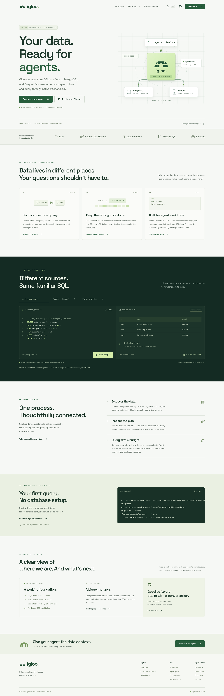

# Igloo website

The product website and documentation for [Igloo](https://github.com/igloodb/igloodb), served at **https://igloodb.github.io**.



## Develop

Use Node.js 22+ and pnpm 8.15.9 (declared in `package.json`).

```sh
corepack enable
pnpm install --frozen-lockfile
pnpm dev
```

The website uses Next.js Pages Router, React, TypeScript, locally bundled fonts, and original SVG diagrams. It exports static HTML with trailing-slash routes. It requires no API server, database, credentials, third-party analytics, or font CDN.

## Validate

Stop the development server before a production build because both use `.next`.

```sh
pnpm build
pnpm check
pnpm exec playwright install --with-deps chromium
pnpm test:e2e
```

`pnpm build` includes TypeScript checks and writes `out/`. `pnpm check` validates all exported pages, local links, assets, metadata, IDs, and fragments. Playwright tests the production export on desktop and mobile: query/cache interactions, keyboard navigation, search, clipboard, docs, 404 recovery, overflow, and automated WCAG A/AA checks. The test runner starts its own static server.

To use an already-installed Chromium, set `PLAYWRIGHT_CHROMIUM_EXECUTABLE_PATH=/path/to/chromium` before running the browser tests. This is useful in environments that restrict browser downloads.

## Publish to GitHub Pages

The workflow in `.github/workflows/pages.yml` builds and tests every pull request. A push to `main` or a manual run on `main` builds, tests, uploads `out/`, and deploys it using the Pages environment. The deployment then verifies the public homepage, pinned agent and connector guides, `llms.txt`, query skill, and commit identifier in `deployment.json`, retrying while CDN edges update. Pull requests do not deploy.

In the GitHub repository settings, set **Pages → Build and deployment → Source → GitHub Actions**. The workflow needs Pages and OIDC write permissions in its deployment job; it uses no stored deployment token. The generated `.nojekyll`, `404.html`, sitemap, and robots file are included in the export. Keep this organization site's root URL as `https://igloodb.github.io`; a project subpath would require a separate `basePath` configuration.

## Content and source accuracy

- `pages/index.tsx`: homepage sections and product narrative.
- `components/playground.tsx`: browser-local query/cache lifecycle illustration. It does not execute SQL or connect to an engine.
- `lib/site.ts`: illustrative examples, canonical URL, and reviewed engine revision.
- `lib/docs.ts`: documentation content, source links, and section structure.
- `lib/agent-doc.ts`: unreleased agent interface onboarding and contract documentation.
- `lib/connector-doc.ts`: database coverage, driver configuration, evidence, and replication roadmap.
- `scripts/generate-agent-docs.mjs`: generates Markdown guides, `llms.txt`, `llms-full.txt` and a copyable query skill from the HTML documentation source during `pnpm build`. Run `pnpm docs:generate` before using these assets in development.
- `pages/docs/[slug].tsx`: statically generated documentation with navigation and table of contents.
- `components/layout.tsx`: navigation, accessible search dialog, metadata, and footer.
- `styles/globals.css`: responsive design, reduced-motion, focus, and print rules.
- `docs/PROJECT_ANALYSIS.md`: source audit and editorial decisions.

Existing engine content is grounded in revision `163320482d98bc3d6c49eb85acb0f511461a8284`; those source links remain pinned for auditability. The agent and connector guides, configuration, architecture, roadmap, and homepage document the experimental source preview at `b5a210d54a2e78a9a8c9497e2476061aad771d36` on `codex/agent-native-access`, explicitly identified as unreleased. `lib/site.ts` supplies the shared clone/checkout commands and pinned source links so visitors can reproduce the documented behavior. The implementation and market research live in the engine's `src/agent.rs`, `src/mcp.rs`, `src/agent_cli.rs`, and `docs/MARKET_ANALYSIS.md`. Update docs plus search/text content together. When adding a route, update `public/sitemap.xml` and the route coverage list in `tests/website.spec.ts`.

Current limitations are explicit: single-node experimental runtime, native PostgreSQL, generic ADBC drivers with PostgreSQL/SQLite 1.7.0 integration coverage, inferred-schema local Parquet, JSON-file CDC with whole-cache invalidation, no actual Iceberg tables, and unauthenticated plaintext pgwire. Other drivers require certification; JDBC/ODBC bridges and replication are roadmap work. The connector guide cites OLake, Columnar, and Apache Arrow primary sources and distinguishes live queries from replication. Walkthrough results are illustrative, without performance claims.

## License

MIT. The original template license is preserved in `LICENSE`.
